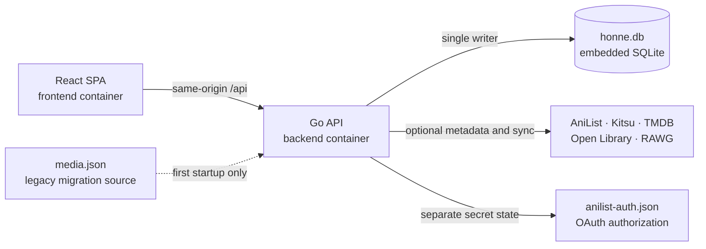
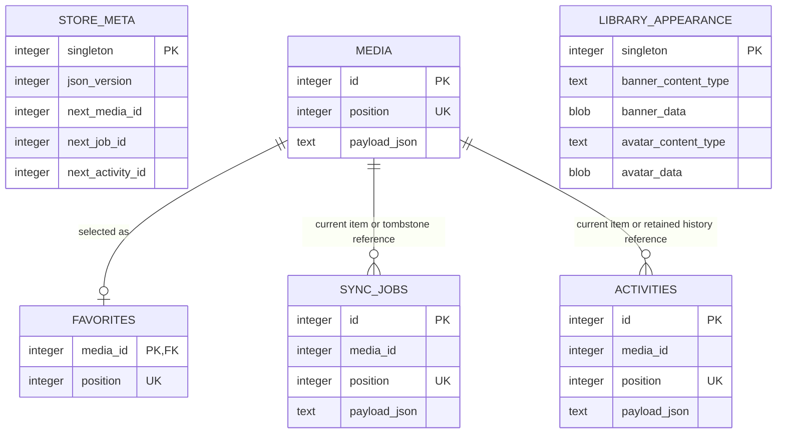
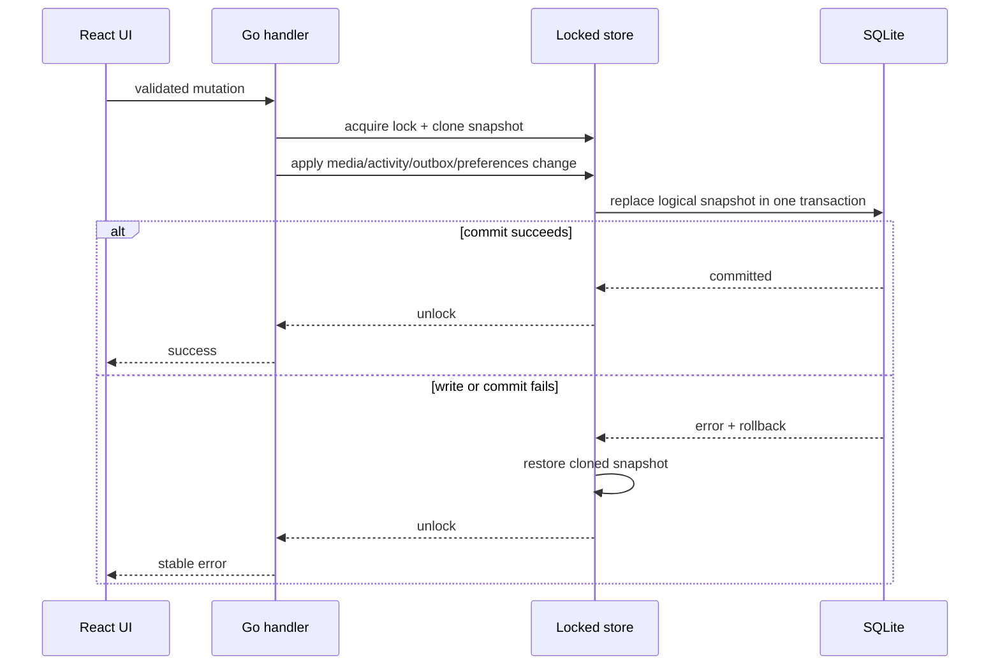
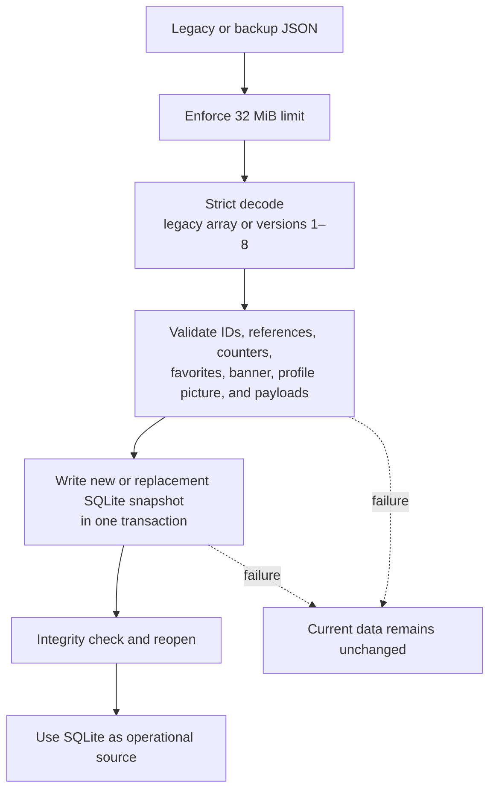
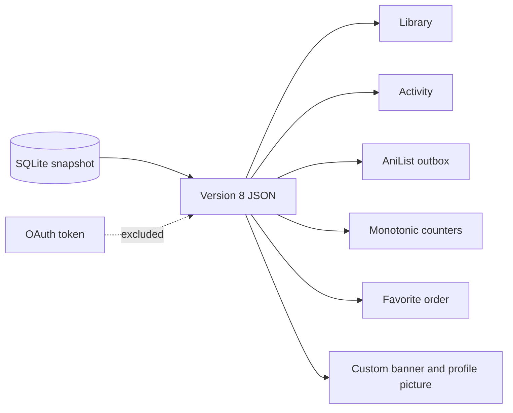

# Honne diagrams

This document describes the current runtime architecture and durable data model. It is intentionally implementation-oriented: when persistence or service boundaries change, update the diagrams in the same commit.

## Runtime architecture

The frontend never opens persistence or contacts authenticated providers directly. The Go backend owns validation, IDs, transactions, provider credentials, and the AniList outbox.

## SQLite model

### Table responsibilities

| Table | Responsibility |
| --- | --- |
| `store_meta` | JSON contract version and monotonic counters. The singleton row is replaced with every logical snapshot. |
| `media` | Ordered Library entries. `payload` preserves the complete validated media contract while the relational key keeps identity explicit. |
| `sync_jobs` | Durable AniList outbox, including jobs that may refer to a locally deleted item. |
| `activities` | Retained local history. Historical rows may refer to deleted media, so they intentionally have no cascading foreign key. |
| `favorites` | Manual order for at most nine existing Library entries. Position `0` is the first tile in the 3×3. |
| `library_appearance` | Singleton local customization. Stores an optional banner up to 8 MiB and profile picture up to 4 MiB as validated JPEG, PNG, WebP, or GIF data. |

`media`, `sync_jobs`, and `activities` keep validated JSON payloads in the first SQLite model. This preserves the established backup contract and avoids scattering provider-specific fields across many nullable columns before their query needs are proven.

## Atomic write boundary

A user-visible success is never returned before the SQLite commit. Library data, Activity, counters, favorites, appearance, and AniList jobs share the same transaction and rollback boundary.

## JSON migration and restore

Startup migration creates `honne.db` only when it does not exist and never changes `media.json`. Settings restore previews the same portable JSON format, requires explicit confirmation, waits for an in-flight AniList operation, and replaces the current snapshot transactionally. AniList OAuth authorization is deliberately excluded from portable backups.

## Backup projection

