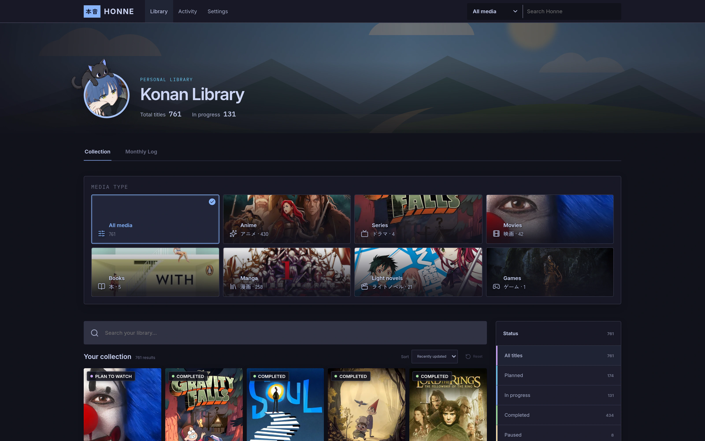
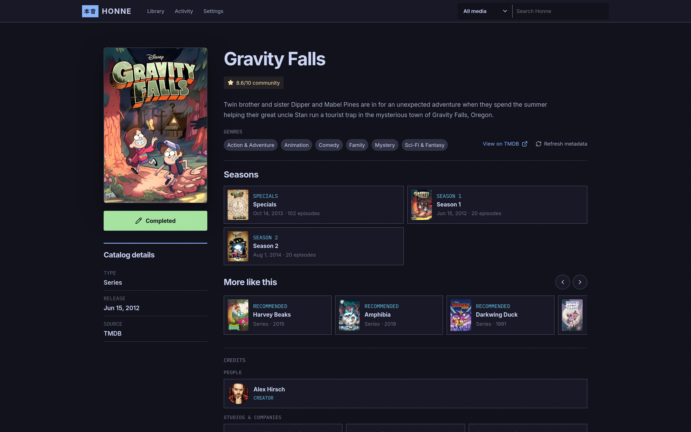
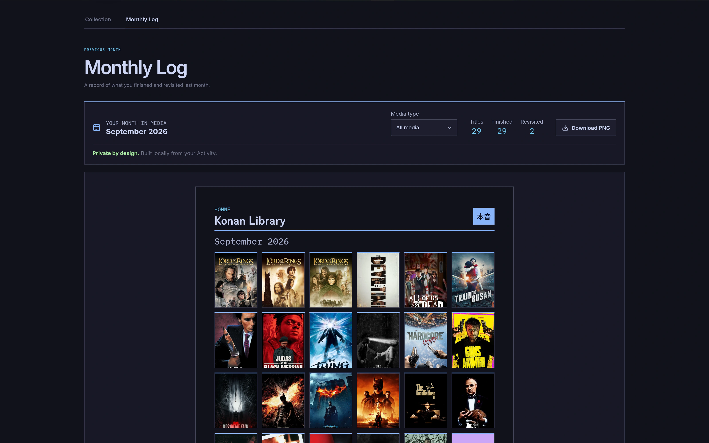

<div align="center">
  
  <h1>Honne</h1>
  <p><strong>Your media life, in one private place.</strong></p>
  <p>
    A self-hosted, local-first library for everything you watch, read, and play.
    Track progress, keep personal notes and ratings, revisit your history, and stay in control of your collection.
  </p>
  <p>
    <a href="https://github.com/GMkonan/honne/releases/latest"></a>
    
    <a href="https://ko-fi.com/konantt"></a>
  </p>
</div>



## One library for every kind of media

Honne brings anime, series, movies, books, manga, light novels, and games into one collection without flattening their differences.

- Track what is planned, in progress, completed, paused, or dropped.
- Record episodes, chapters, pages, playtime, ratings, and private notes.
- Plan a rewatch, reread, replay, or revisit without changing a completed title's status.
- Search and filter the whole collection or focus on one media type.
- Review a local Activity history of additions, progress, ratings, completions, and revisits.

## Rich context, optional catalogs

Manual tracking works without an account or external provider. When configured, Honne can enrich titles with covers, descriptions, release information, seasons, collections, recommendations, contributors, and related works.



| Provider | Media | Credentials |
| --- | --- | --- |
| AniList with Kitsu fallback | Anime, manga, and light novels | None for discovery |
| TMDB | Movies and series | API Read Access Token |
| Open Library | Books | None; contact email recommended |
| RAWG | Games | API key |

AniList account connection is optional and enables one-way synchronization from Honne for linked entries. Provider credentials stay in the backend and are never exposed to frontend code.

## Remember what the month felt like

Monthly Log turns the previous month's completed and revisited titles into a private visual record. Filter it by media type and download a shareable PNG generated locally in the browser.



## Own the collection

- Runs as two Docker containers with a persistent local volume.
- Stores Library state and the AniList outbox transactionally in embedded SQLite.
- Keeps the Library usable when optional catalog providers are unavailable.
- Provides portable JSON backups for the collection, Activity, counters, and synchronization queue.
- Sends no analytics, telemetry, collection data, or generated Monthly Log images to third parties by default.
- Supports optional Basic Auth for deployments outside a trusted private network.

## Quick start

A release installation needs Docker Compose and the two files attached to the latest release. Git and the source tree are not required.

```bash
mkdir -p ~/honne && cd ~/honne
curl -fLO https://github.com/GMkonan/honne/releases/latest/download/compose.yaml
curl -fLO https://github.com/GMkonan/honne/releases/latest/download/env.example
cp -n env.example .env
chmod 600 .env
```

Review `.env`, then start Honne:

```bash
docker compose config --quiet
docker compose pull
docker compose up -d
```

Open [http://localhost:7417](http://localhost:7417). Your collection is stored in the `honne-data` Docker volume and survives container replacement.

> Before updating an existing installation, download a backup and review the version-specific rollback notes in the self-hosting guide.

## Documentation

- **[Self-hosting](docs/self-hosting.md)** — installation, configuration, authentication, backup, restore, updates, and rollback.
- **[AniList synchronization](docs/anilist-sync.md)** — connect an account and understand synchronization behavior.
- **[Development](docs/development.md)** — build from source, run validation, and use the API.
- **[Architecture diagrams](DIAGRAMS.MD)** — runtime boundaries, SQLite model, transactions, migration, and backup projection.
- **[Product roadmap](docs/product/roadmap.md)** — current priorities and future product direction.

## Build from source

```bash
cp -n .env.example .env
docker compose up -d --build
```

The source Compose environment also opens on [http://localhost:7417](http://localhost:7417). See the [development guide](docs/development.md) for local processes and the complete validation contract.

## Support Honne

If Honne is useful to you, you can support its continued development on [Ko-fi](https://ko-fi.com/konantt).

## Catalog acknowledgements

Catalog metadata and artwork may be provided by [AniList](https://anilist.co), [Kitsu](https://kitsu.app), [TMDB](https://www.themoviedb.org), [Open Library](https://openlibrary.org), and [RAWG](https://rawg.io). This product uses the TMDB API but is not endorsed or certified by TMDB.
